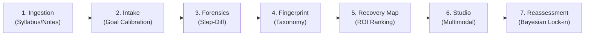

# EduTrace AI — Hackathon Pitch Slide Deck Structure
**Team Cognix** | 8-Slide Pitch Deck Specification

---

## 📊 Slide Overview

- **Slide 1:** Title & Mission: EduTrace AI — Academic Forensic & Metacognitive Intervention Platform
- **Slide 2:** The Problem: The "Bury the Post-Mortem" Crisis in STEM Higher Education
- **Slide 3:** The Solution: The 7-Stage Clinical Recovery Pipeline
- **Slide 4:** System Architecture: Vector RAG, Algorithmic Step-Diff, & Bayesian Learning Twin
- **Slide 5:** Live Product Walkthrough: From 50% Baseline to 75+ Target in 5 Days
- **Slide 6:** Multimodal Studio & Adaptive Interventions: 4 Pedagogical Channels
- **Slide 7:** Benchmark Results & Empirical Evaluation: 15 Multi-Subject Cases (100% Acc, 97.7% Macro-F1)
- **Slide 8:** Market Opportunity, Business Model, & Team Cognix

---

### Slide 1: Title & Mission
- **Header:** EduTrace AI
- **Subheader:** Turning Academic Post-Mortems into Clinical Marks Recovery
- **Tagline:** The Metacognitive Forensic & Bayesian Learning Twin Platform
- **Team:** Team Cognix (5 Vertical Pods: Architecture, Ingestion RAG, Intake Probe, Forensics Diff, Recovery Studio)
- **Visual:** Glowing 3D brain circuit connected to mathematical derivation tree and Bayesian distribution curves.

---

### Slide 2: The Problem
- **Headline:** 38% of STEM Undergraduates Fail or Drop Out After Midterm 1
- **The Core Pains:**
  1. **The Post-Mortem Burial:** Graded papers return marked with a red "50/100" with zero step-level localization. Students bury the exam and lose hope.
  2. **Office Hour Scarcity:** 1 Professor + 2 TAs cannot provide 1-on-1 step-level diagnostics for 300+ students.
  3. **LLM Hallucination Trap:** Students paste prompts into ChatGPT, which dumps ungrounded answers that violate the professor's specific rubric rules.
- **Visual:** Split graphic: Frustrated student with red-penciled exam paper vs generic AI hallucinating wrong bracket notation.

---

### Slide 3: The Solution (The 7-Stage Pipeline)
- **Headline:** A Comprehensive Closed-Loop Academic Recovery System

- **Key Differentiator:** Closed-loop verification. We don't just explain mistakes; we verify recovery through isomorphic drills and update the student's Bayesian belief state.

---

### Slide 4: System Architecture & Data Foundations
- **Headline:** Zero Hallucination. Rigorous Bayesian Inference.
- **Technical Pillars:**
  - **Stage 1 & 2 RAG Knowledge Mesh:** ChromaDB / SQLite vector embeddings indexing professor lecture slides, syllabi, and past exam keys with metadata-filtered retrieval.
  - **Stage 3 & 4 Forensic Algorithmic Diff:** Line-by-line derivation parser identifying first point of divergence and classifying into 4-category cognitive error taxonomy (`procedural_calculation`, `method_selection`, `conceptual_misunderstanding`, `rubric_omission`).
  - **Stage 5 & 7 Bayesian Learning Twin:** Conjugate $\text{Beta}(\alpha, \beta)$ belief state modeling student mastery distributions with credible confidence intervals.
- **Visual Architecture Diagram:** End-to-end data flow from PDF ingestion through FastAPI routers to React Vite Shell.

---

### Slide 5: Live Product Walkthrough
- **Headline:** Case Study: Rahul's Calculus III Recovery
- **The Scenario:**
  - Current Baseline: **50 / 100**
  - Goal: **75+**
  - Timeline: **5 Days remaining**
  - Recoverable Gap: **25 Marks**
- **The Finding:** Question 3 failed at Step 3 due to procedural sign inversion during repeated integration by parts.
- **RAG Grounding:** Direct vector retrieval from **Prof Kapoor Lecture Notes — Module 2, Slide 19**: *"When repeating integration by parts, always enclose the entire second iteration in brackets..."*

---

### Slide 6: Multimodal Intervention Studio
- **Headline:** 4 Adaptive Modalities Tailored to Every Learning Style
- **Modality Breakdown:**
  1. **Visual Mermaid Decision Flowcharts:** Step-by-step logic trees for method selection.
  2. **Interactive Spot-The-Bug Drills:** Active recall micro-challenges where students click the exact diverged line.
  3. **Real-World Physical Analogies:** "The Nested Suitcase Rule" demystifying abstract bracket distribution.
  4. **60-Second Audio Deconstructions:** Synthesized verbal takeaways with live animated waveform visualizer (Feature Proposal #006).

---

### Slide 7: Benchmark Results & Empirical Evaluation
- **Headline:** Rigorous Evaluation Across 15 Multi-Subject Gold Cases
- **Evaluation Metrics (Runner Data):**
  - **Total Annotated Cases:** `15` (Calculus III, Linear Algebra, Differential Equations, Macroeconomics)
  - **Step Divergence Localization Accuracy:** `100.0%` (15/15 points of divergence identified)
  - **Cognitive Taxonomy Macro-F1:** `97.7%`
  - **Marks Estimation MAE:** `0.00`
- **Benchmark Chart Preview:**
  - Bar graph showing 100% localization accuracy and 0.977 Macro-F1 across procedural, conceptual, method selection, and rubric omission errors.

---

### Slide 8: Market Opportunity & Team Cognix
- **Headline:** Scalable EdTech Infrastructure for Universities & Test Prep
- **Target Audience:**
  - Higher Education institutions (Canvas / Blackboard LTI integration).
  - High-stakes test prep (AP Calculus, GRE, MCAT, CFA).
- **Business Model:** B2B SaaS licensing per university seat ($8/student/semester) + B2C direct student subscription ($12/month).
- **Team Cognix:**
  - **P1:** Tech Lead & Core Systems (Architecture, Bayesian Engine, Shell)
  - **P2:** Stage 1 Ingestion & RAG Knowledge Lead
  - **P3:** Stage 2 Intake & Diagnostic Probe Lead
  - **P4:** Stage 3 Forensics Diff & Error Taxonomy Lead
  - **P5:** Stage 5/6 Recovery Map, Studio & Evaluation Lead
